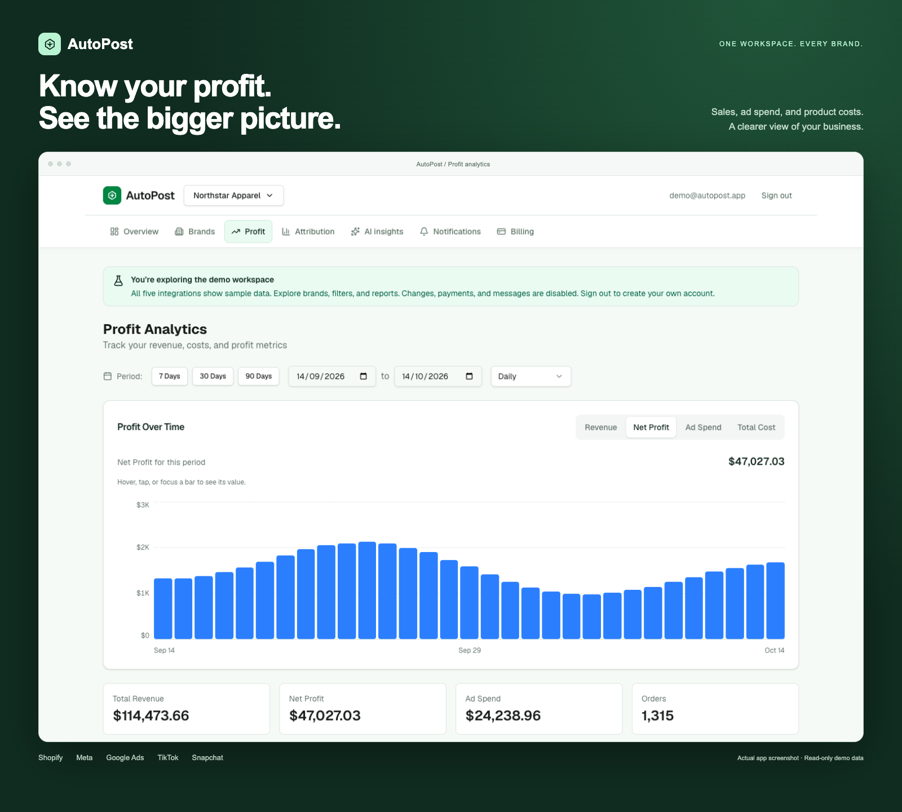

# AutoPost

**Multi-brand advertising analytics, profit tracking, and AI-assisted insights in one workspace.**

AutoPost brings Shopify sales and Meta, Google, TikTok, and Snapchat ad performance together. Track profit after product costs and expenses, compare brands, review recommendations, and stay informed through Telegram summaries and alerts.

[Explore the demo](https://autopost-sepia.vercel.app/login?demo=1) · [Deployment guide](DEPLOYMENT.md) · [Test suite](tests/README.md)

[](https://autopost-sepia.vercel.app/login?demo=1)

*Actual AutoPost dashboard with read-only sample data. Select the preview to explore the demo.*

## Product overview

| Area | What you can do |
| --- | --- |
| **Brands** | Organize separate brands, switch workspaces, compare performance, and assign owner, manager, or viewer access. |
| **Integrations** | Connect Shopify and four advertising platforms, sync orders and campaign metrics, and monitor connection status. |
| **Profit** | Review revenue, refunds, COGS, estimated transaction fees, ad spend, and custom expenses with daily, weekly, monthly, or overall reporting. |
| **Attribution** | Inspect platform and campaign attribution reports alongside conversion event history and CAPI platform filters. |
| **AI insights** | Review trends, anomalies, and recommendations using Gemini or Anthropic, with a labelled rules-based fallback when AI is unavailable. |
| **Notifications** | Configure Telegram alerts, daily and weekly summaries, thresholds, timezones, and quiet hours. Review delivery history. |
| **Billing** | View subscription details and invoices. Configure Polar for live checkout and subscription management. |

AI recommendations are advisory: campaign changes and budgets remain under your control. Live integrations require account credentials and provider configuration; the demo is ready to explore without connecting external accounts.

## Demo workspace

On the login page, select **Fill demo credentials**, then **Sign in**. The registration page also provides a demo link.

| Field | Public demo credentials |
| --- | --- |
| Email | `demo@autopost.app` |
| Password | `DemoPass123!` |

Explore **Northstar Apparel**, **Terra Home**, and **Bloom Skincare** with sample data across all five integrations, profit reports, attribution, AI insights, notifications, and a sample Pro subscription with invoices. Date filters, report granularity, brand switching, and pagination are interactive.

The demo uses an isolated, signed sample identity. Data is generated without database seeding; dates stay current automatically. Demo requests cannot change records, access real brands, charge cards, send messages, or call live integration services. Brand selection is stored in each visitor’s cookie.

Demo access is enabled by default in development and production. Set `DEMO_ENABLED=false` to disable it. Sign out to create or use a real account.

## Technology

| Layer | Stack |
| --- | --- |
| Application | Next.js 16 App Router, React 19, TypeScript |
| Interface | Tailwind CSS 4, Radix UI, Lucide icons |
| Data fetching and validation | SWR, Zod |
| Authentication | Auth.js 5 with credentials and optional Google OAuth |
| Database | Neon PostgreSQL with Drizzle ORM |
| AI providers | Google Gemini and Anthropic |
| Notifications and billing | Telegram Bot API and Polar |
| Testing | Node test runner with tsx, Playwright |
| Hosting and scheduling | Vercel with authenticated cron routes |

## Local development

### Requirements

- **Node.js 24**; the repository includes `.nvmrc`.
- **pnpm 12.4.2**, pinned in `package.json`.
- A **Neon PostgreSQL** database for application accounts and live data.

### 1. Install dependencies

```sh
git clone https://github.com/aialvi/autopost.git
cd autopost
nvm use
pnpm install --frozen-lockfile
```

### 2. Configure the environment

```sh
cp .env.example .env.local
```

Set the core values in `.env.local`:

| Variable | Purpose |
| --- | --- |
| `DATABASE_URL` | Neon PostgreSQL connection string. |
| `AUTH_SECRET` | Random secret used to sign authentication sessions. |
| `ENCRYPTION_KEY` | 64 hexadecimal characters used to encrypt stored integration credentials. |
| `CRON_SECRET` | Random secret protecting scheduled-job endpoints. |
| `NEXT_PUBLIC_APP_URL` | Application URL; use `http://localhost:3000` locally. |
| `DEMO_ENABLED` | Public demo availability; defaults to `true`. |

Generate independent secrets locally:

```sh
openssl rand -base64 32  # AUTH_SECRET
openssl rand -hex 32     # ENCRYPTION_KEY
openssl rand -hex 32     # CRON_SECRET
```

Keep the encryption key stable so saved credentials remain readable. External provider keys are only needed for the services you enable. See [DEPLOYMENT.md](DEPLOYMENT.md) for OAuth, platform connections, AI providers, Telegram, and Polar configuration.

### 3. Initialize the database

Apply the checked-in migrations to a fresh database:

```sh
node --env-file=.env.local node_modules/drizzle-kit/bin.cjs migrate
```

For an existing database, review its migration history before applying schema changes. Drizzle CLI commands need the connection string loaded explicitly; Next.js loads `.env.local` when the app starts.

### 4. Start the app

```sh
pnpm dev
```

Open [localhost:3000](http://localhost:3000). Create an account and brand for your own data, or use the public demo credentials.

## Profit reporting

```text
Net profit = Revenue after refunds
           − COGS
           − Transaction fees
           − Ad spend
           − Custom expenses
```

Known product costs supply COGS; missing costs fall back to the brand’s configured percentage. Recurring expenses apply to the relevant reporting dates. Reports respect brand timezones, and repeated ad syncs update the same daily snapshot.

Transaction fees currently use gateway-rate estimates. Connect accounts in the brand’s reporting currency; automatic currency conversion is not provided. Platform-attributed revenue can overlap across attribution windows and should be interpreted alongside Shopify revenue and blended performance.

## Testing and quality checks

```sh
pnpm lint
pnpm exec tsc --noEmit
pnpm test
pnpm build

# Install Chromium once, then run desktop/mobile browser and API tests.
pnpm exec playwright install chromium
pnpm test:e2e
```

The default backend suite uses controlled provider responses and does not load the development or production database. Database integration tests are skipped unless `TEST_DATABASE_URL` is explicitly provided.

The browser suite covers registration, login, brand switching, dashboard tabs, report controls, charts, responsive layouts, API authentication, webhook rejection, and demo mutation restrictions. It starts a local server or reuses one already running.

With a server running, check the authenticated demo HTTP flows:

```sh
pnpm test:demo

# Check an existing deployment.
DEMO_TEST_URL=https://your-deployment.vercel.app pnpm test:demo
PLAYWRIGHT_BASE_URL=https://your-deployment.vercel.app pnpm test:e2e
```

For database integration tests, set `TEST_DATABASE_URL` in `.env.test.local` to a separate, migrated test database, then run `pnpm test:integration`. See [tests/README.md](tests/README.md) for the coverage matrix, failure reports, and test setup. Live account permissions, real payments, AI responses, and Telegram delivery require separate provider checks.

## Deployment and automation

AutoPost is configured for Vercel. Production needs the core environment values, a migrated database, and credentials for any live services you enable. Vercel cron handles platform sync, summaries, and anomaly checks.

GitHub CI runs a frozen pnpm install, lint, type checks, backend tests, a production build, and browser/API tests using synthetic configuration. The additional deployment, sync, migration, and security workflows are preserved and temporarily opt-in through repository variables.

- [Deployment and integration setup](DEPLOYMENT.md)

## Repository layout

```text
.github/                 CI workflows and shared setup action
src/
  app/
    (auth)/              Login and registration
    (dashboard)/         Protected dashboard pages
    api/                 Brand, reporting, integration, webhook, and cron routes
    page.tsx             Landing page
  components/            Marketing, dashboard, reporting, and shared UI
  lib/
    auth/                Authentication and brand permissions
    db/                  Drizzle database client and schemas
    demo/                Isolated sample identity and data
    platforms/           Shopify and advertising API clients
    profit/              Accounting calculations and report aggregation
    attribution/         Touchpoints and attribution reporting
    ai/                  Analysis and AI provider handling
    telegram/            Notifications and delivery handling
    payments/            Polar billing integration
    jobs/                Authenticated scheduled-job logic
  proxy.ts               Route protection and demo mutation guard
drizzle/                 Checked-in database migrations
scripts/                 Sync runner and demo HTTP checks
tests/                   Backend, database integration, and browser suites
```

## Commands

| Command | Purpose |
| --- | --- |
| `pnpm dev` | Start the development server. |
| `pnpm build` | Build the production application. |
| `pnpm start` | Serve an existing production build. |
| `pnpm lint` | Run ESLint. |
| `pnpm test` | Run isolated backend tests. |
| `pnpm test:e2e` | Run browser and API tests. |
| `pnpm test:e2e:ui` | Open the interactive Playwright runner. |
| `pnpm test:integration` | Run database integration tests with an explicit test database. |
| `pnpm test:demo` | Check demo HTTP flows against a running server. |
| `pnpm db:generate` | Generate migrations after schema changes. |
| `pnpm db:migrate` | Apply migrations with database configuration loaded. |
| `pnpm db:push` | Apply the current schema directly; review changes before use. |
| `pnpm db:studio` | Open Drizzle Studio with database configuration loaded. |
